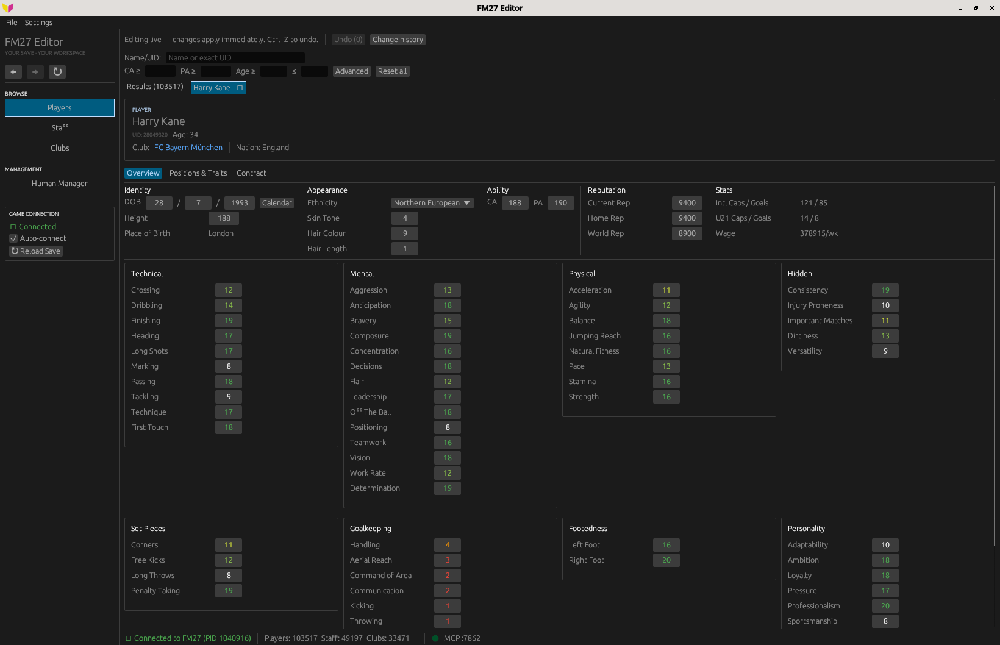
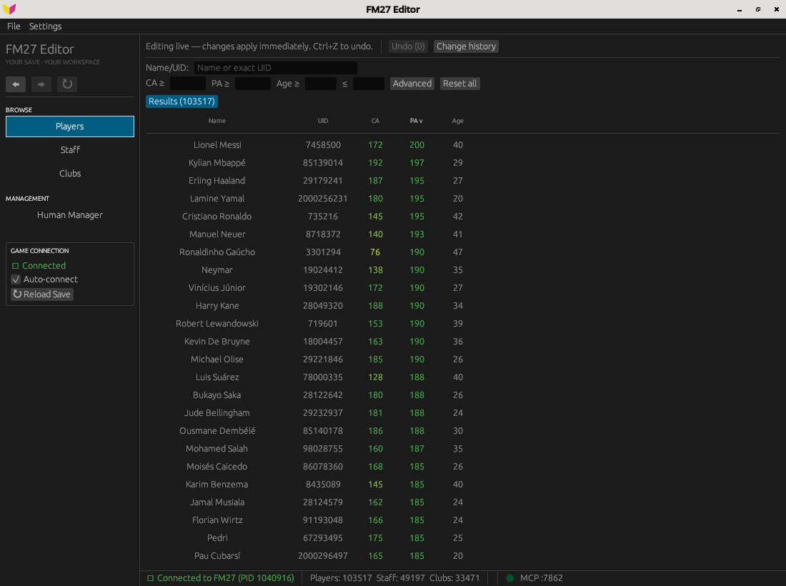
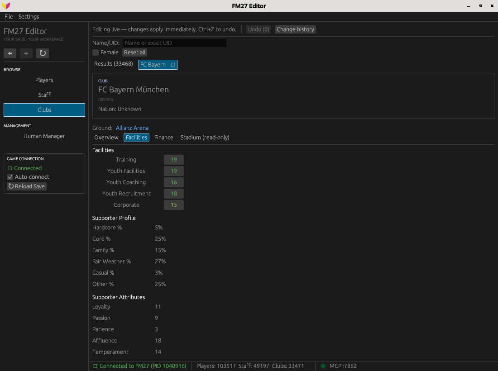

# fm-editor

A real-time memory editor for **Football Manager 24, 26 and 27**. It attaches to a running
`fm.exe`, finds every player, staff member and club in the loaded save, and lets you browse
and edit them while the game runs. Every write goes through an undo stack.

It runs natively on **Windows** and on **Linux**, where it attaches to FM running under
Steam's Proton.

> **Back up your save before editing.** fm-editor writes directly into the game's memory.
> Edits become part of the save once FM saves the game. Use it on offline, single-player
> saves only.

## Features

- **Players** — attributes, positions, CA/PA, personality, reputation, date of birth, traits;
  club, nationality, place of birth, international caps; contract wage, expiry, squad status,
  squad number and asking price.
- **Staff** — coaching, mental and knowledge attributes, reputation, personality; job,
  employer, wage and contract expiry.
- **Your manager** — the same staff view for the human manager.
- **Clubs** — facilities, supporter profile, reputation, balance, transfer and wage budgets,
  ticket price, stadium names and capacity.
- **Search** — players, staff and clubs by name, UID and filters.
- **Undo** — every edit, one step at a time.

What can be read and edited differs by game version; see the memory-layout notes below.

## Screenshots

Captured from the running editor with FM27 on Linux. Available fields vary by game
build; these screenshots do not imply feature parity across all supported versions.

### Player profile



<details>
<summary>Player search</summary>

Live name/UID filtering, ability and age filters, and sortable results.



</details>

<details>
<summary>Club facilities and supporters</summary>



</details>

## Supported versions

| Game | Status | Notes |
|------|--------|-------|
| FM24 | Players, staff, clubs, stadiums | [docs/fm24/memory-layout.md](docs/fm24/memory-layout.md) |
| FM26 | Main target (2026-10 patch) | [docs/fm26/memory-layout.md](docs/fm26/memory-layout.md) |
| FM27 | In progress — most fields verified against a live save | [docs/fm27/memory-layout.md](docs/fm27/memory-layout.md) |
| FM27 (Game Pass) | Unverified — attaches with the Steam layout; may not read correctly | [Game Pass build](docs/fm27/memory-layout.md#game-pass-build) |

The version is detected from the game's install path when the editor attaches, and so is the
storefront: a PC Game Pass (Xbox app) install is a different build from Steam's and gets its own
schema. Only the Steam builds are mapped; FM27 on Game Pass is an untested starting point.
A game patch can move fields. For builds with a recorded module fingerprint, the
editor rejects a mismatch. Uncalibrated builds (currently FM27) can attach with a
warning, without that fingerprint guard; a successful attachment does not prove
that their layouts are verified.

Several versions can be open at once (they all run as `fm.exe`). The editor then attaches to
none of them on its own: the toolbar shows one button per running game, labelled with its
version and PID, and the status bar names the game you attached to. Each game is read with
its own schema.

## Test-build downloads

The **Build and package** workflow in [GitHub Actions](https://github.com/barak14/fm-editor/actions)
builds Windows x86-64 ZIP and Linux x86-64 tar.gz test packages, with matching source
archives and SHA-256 checksums. Select a successful run for the intended commit and
download its platform artifact (GitHub sign-in required; artifacts expire after 14 days).

These are unsigned test builds, not published releases. See [the packaging guide](docs/releases.md)
for extraction, Linux requirements, verification limits and the public-release checklist.

## Building

Requires a recent stable Rust toolchain (edition 2024).

```bash
cargo build --release
./target/release/fm-editor
```

Debug builds (`cargo build`) also start the fm-debug MCP server described below.

### Linux / Proton

The editor reads FM's memory with `process_vm_readv` / `process_vm_writev`. With the common
default `kernel.yama.ptrace_scope=1`, the kernel blocks that for unrelated processes. Either
relax it for the session:

```bash
sudo sysctl kernel.yama.ptrace_scope=0
```

or grant the binary the capability (re-apply after every rebuild):

```bash
sudo setcap cap_sys_ptrace+ep target/release/fm-editor
```

## Usage

1. Start Football Manager and load a save.
2. Start fm-editor. It attaches automatically and loads the save's players, staff and clubs.
3. Search for a player, staff member or club and open it. Edit a value; press Enter or click
   away to apply it. **Undo** reverts edits one at a time.
4. Continue in FM. Some changes show at once; others appear after the game advances a day.

See [docs/ui-guide.md](docs/ui-guide.md) for navigation and search details.

## fm-debug MCP server

Debug builds serve an [MCP](https://modelcontextprotocol.io) server on
`http://localhost:7799/mcp` while the editor runs (`--mcp-port <n>` changes the port). Its
read-only tools — `search_entities`, `dump_struct`, `probe_range`, `probe_pointer_chain`,
`compare_entities`, `read_entity_fields` and others — inspect live game memory, which is how
new fields are mapped. [`.mcp.json`](.mcp.json) is an example client configuration.

## Contributing

[AGENTS.md](AGENTS.md) is the shared, harness-neutral project guide: schema-only offsets,
two independent witnesses for mappings, and acknowledged undo for every write.
[Development procedures](docs/development.md) cover field research, verification,
debug tools and worktree helpers. [ROADMAP.md](ROADMAP.md) is a feature backlog;
superseded implementation plans and session logs remain in Git history, not as active tasks.

## Credits

The FM27 profile published with the GPL-3.0
[FM27€0](https://sortitoutsi.net) editor by Anze Alexander was used as a cross-reference for
FM27 leads; every offset taken from it was re-verified against a live save. No code was
taken from it.

## License

[GPL-3.0-or-later](LICENSE).

Football Manager is a trademark of Sports Interactive / SEGA. This project is not affiliated
with or endorsed by them.
