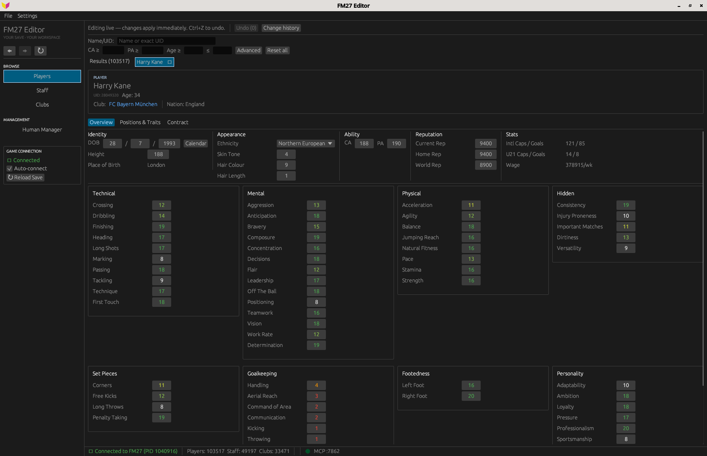
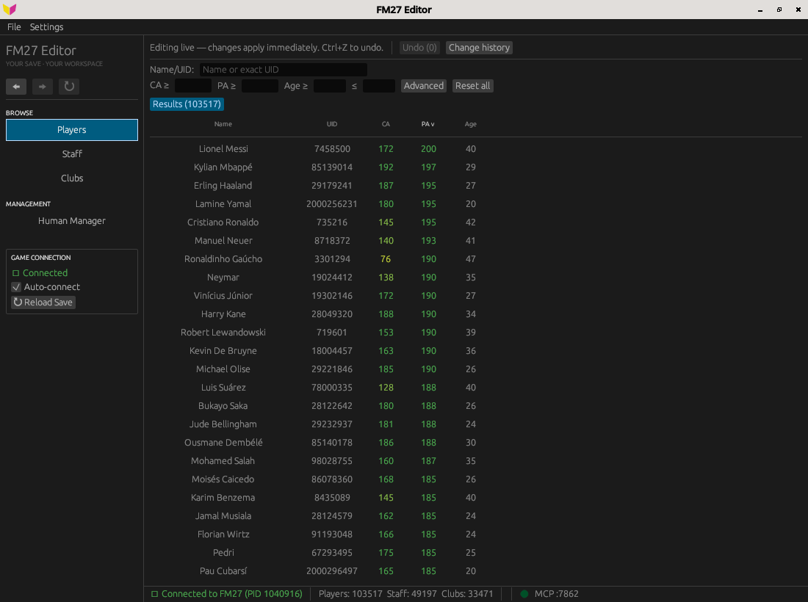
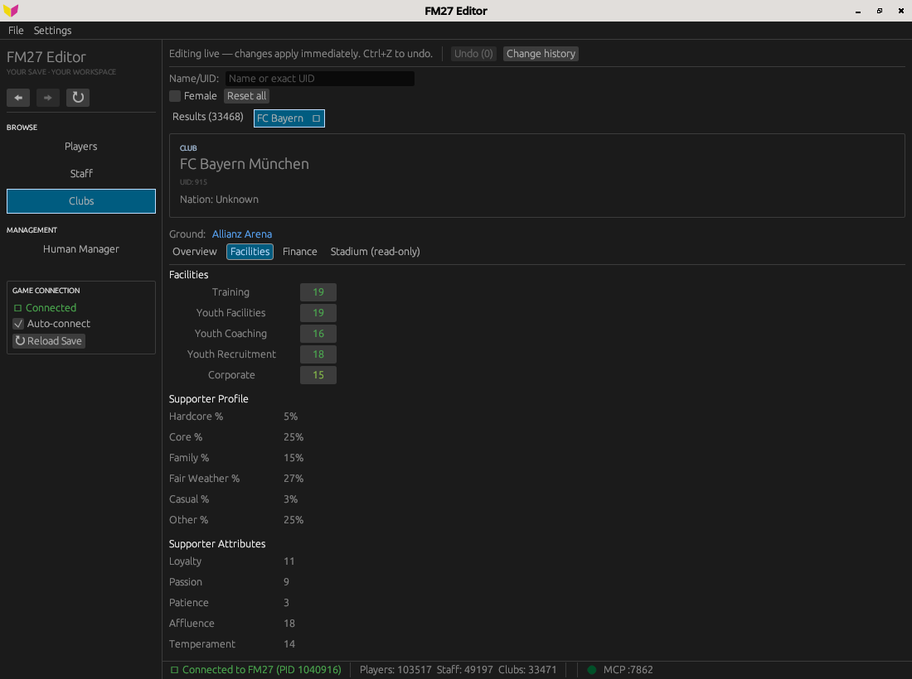

# fm-editor

A real-time memory editor for **Football Manager 24, 26 and 27**. It attaches to a running
`fm.exe`, finds every player, staff member and club in the loaded save, and lets you browse
and edit them while the game runs. Every write goes through an undo stack.

It runs natively on **Windows** and on **Linux**, where it attaches to FM running under
Steam's Proton.

> **Back up your save before editing.** fm-editor writes directly into the game's memory.
> Edits become part of the save once FM saves the game. Use it on offline, single-player
> saves only.

## Features

An experimental Windows FM27 Steam **club-policy trial** is available only with
explicit `--enable-policy-trial` startup. It proposes allowing Part Time offers
for an all-Non-Contract club policy; direct player-contract conversion remains
disabled. Read the [evidence, separate-copy requirements and trial instructions](docs/fm27/contract-type-investigation.md#guarded-club-policy-workaround-implemented-live-trial-outstanding)
before using it. Offer controls, Undo, policy persistence and an accepted Part Time deal have
been tested; accepted-contract reload and salary-payment checks remain.
The trial and contract-inspection diagnostics require the specific witnessed
Windows FM27 Steam fingerprint; imported builds do not enable them.

- **Players** — attributes, positions, CA/PA, personality, reputation, date of birth, traits;
  club, nationality, place of birth, international caps; contract wage, expiry, squad status,
  squad number and asking price.
- **Player comparison** — select a player, then compare another against them in a read-only, colour-coded view with named columns and available age, CA/PA and contract context. [Workflow and limitations](docs/ui-guide.md#player-comparison).
- **Staff** — coaching, mental and knowledge attributes, reputation, personality; job,
  employer, wage and contract expiry.
- **Your manager** — the same staff view for the human manager.
- **Clubs** — facilities, supporter profile, reputation, balance, transfer and wage budgets,
  ticket price, stadium names and capacity.
- **Search** — players, staff and clubs by name, UID and filters.
- **Undo** — every edit, one step at a time.

What can be read and edited differs by game version; see the memory-layout notes below.

## Screenshots

Captured from the running editor with FM27 on Linux. Available fields vary by game
build; these screenshots do not imply feature parity across all supported versions.

### Player profile



<details>
<summary>Player search</summary>

Live name/UID filtering, ability and age filters, and sortable results.



</details>

<details>
<summary>Club facilities and supporters</summary>



</details>

## Supported versions

| Game | Status | Notes |
|------|--------|-------|
| FM24 | Players, staff, clubs, stadiums | [docs/fm24/memory-layout.md](docs/fm24/memory-layout.md) |
| FM24 (Epic) | Steam schema with the Epic fingerprint for 24.4.2+2081827; two players and one club checked in game, including an edit and restore, by a contributor | [Epic build](docs/fm24/memory-layout.md#epic-build) |
| FM26 | Main target (2026-10 patch) | [docs/fm26/memory-layout.md](docs/fm26/memory-layout.md) |
| FM27 | In progress — most fields verified against a live save | [docs/fm27/memory-layout.md](docs/fm27/memory-layout.md) |
| FM27 (Game Pass) | Bring-up on Store packages 0.9.2435.0 (27.0.1) and 0.9.2524.0 (27.1) — players, staff, clubs, date and manager read correctly; one edit/Undo checked in game on 0.9.2435.0 | [Game Pass build](docs/fm27/memory-layout.md#game-pass-build) |
| FM27 (imported) | Steam 27.0.0+2493426, 27.0.1+2494687, 27.0.1+2503222 and 27.1.0+2505117; Game Pass 27.0.0+2493426 — from another editor's offsets, not checked here | [Imported builds](docs/fm27/memory-layout.md#imported-builds) |

The release is detected from the game module's Windows PE product metadata:
`fm.exe` for FM24, `game_plugin.dll` for FM26/FM27 (their exe reports the Unity
engine version). If no FM product identity is available, the editor falls back
to a recognised install-directory name, including compact `FootballManager24`
names. Explicit unsupported/conflicting FM product names are rejected rather
than overridden by the directory. This works on Windows and Linux/Proton.

Storefront detection remains separate, using install-location hints and the
Game Pass manifest. A matching module fingerprint or PE timestamp and image size
pins a recorded build of the same release and corrects the storefront hint, even
for a moved install.
Unrecognised locations retain the historical Steam default. FM24 Epic uses Steam's
layout and addresses; only a few of its fields have Epic witnesses, and the
maintainer cannot test it. FM27 Game Pass has its own recorded module addresses;
features that depend on unmapped addresses stay disabled.

Other builds of FM24, FM26 and FM27, including storefronts without a recorded build
and patched executables, try that release's recorded address sets. Once a save is
loaded, a read-only decoding gate checks players, staff, clubs and related records
before the editor makes an unpinned build available for editing. A failure refuses
the attachment rather than displaying guessed data. When no recorded address set
fits (for example after a game update moved them), the editor scans the game module
for the entity arrays and runs the same gate on what it finds. A build opened this
way is **read-only** and labelled **(read-only: detected addresses)**; its detection
log entry contains the found addresses, which can be recorded once they are
confirmed in game. Unknown releases are refused. Matching or scanned addresses do
not establish that every field has been independently verified on that build.

Matched, unpinned builds and pinned builds whose mappings haven't been checked
here show an **amber version label** with a backup warning. While waiting for
validation, the label adds **(checking layout…)**. **Back up your save before
editing.** The gate runs again after every
save load/reload; pinned builds also run it, but a failure warns instead of blocking.
If a save is loaded but the editor keeps waiting and reports **No save found —
this build may be unsupported**, the build's addresses have probably moved;
report it with the detection log below.

For identification failures, include the [game-detection log](docs/development.md#release-identification-diagnostics)
in your bug report. It records the candidate PID, actual module paths, PE product
and file versions, discovery/resource errors and the selection result. Windows:
`%LOCALAPPDATA%\fm-editor\logs\game-detection.log`; Linux:
`~/.local/share/fm-editor/logs/game-detection.log` (or under `XDG_DATA_HOME`).
Review paths for personal information before sharing. Repeated identical reports
are suppressed and the log rotates with one backup to keep its size bounded.

Several versions can be open at once (they all run as `fm.exe`). The editor then attaches to
none of them on its own: the toolbar shows one button per running game, labelled with its
version and PID, and the status bar names the game you attached to. Each game is read with
its own schema.

## Test-build downloads

The **Build and package** workflow in [GitHub Actions](https://github.com/barak14/fm-editor/actions)
builds Windows x86-64 ZIP and Linux x86-64 tar.gz test packages, with matching source
archives and SHA-256 checksums. Select a successful run for the intended commit and
download its platform artifact (GitHub sign-in required; artifacts expire after 14 days).

These are unsigned test builds, not published releases. See [the packaging guide](docs/releases.md)
for extraction, Linux requirements, verification limits and the public-release checklist.

### Native installation

The [native package guide](docs/native-packages.md) covers the per-user Windows
installer and the Arch/CachyOS `fm-editor-bin` package, with Start Menu/desktop
integration and uninstall instructions. They wrap the same tested application
binaries as the portable downloads; no automatic memory-access privilege changes
are made. Native packages remain unsigned and the release remains a preview.

## Building

Requires a recent stable Rust toolchain (edition 2024).

```bash
cargo build --release
./target/release/fm-editor
```

Debug builds (`cargo build`) also start the fm-debug MCP server described below.

### Linux / Proton

The editor reads FM's memory with `process_vm_readv` / `process_vm_writev`. With the common
default `kernel.yama.ptrace_scope=1`, the kernel blocks that for unrelated processes. Either
relax it for the session:

```bash
sudo sysctl kernel.yama.ptrace_scope=0
```

or grant the binary the capability (re-apply after every rebuild):

```bash
sudo setcap cap_sys_ptrace+ep target/release/fm-editor
```

## Usage

1. Start Football Manager and load a save.
2. Start fm-editor. It attaches automatically and loads the save's players, staff and clubs.
3. Search for a player, staff member or club and open it. Edit a value; press Enter or click
   away to apply it. **Undo** reverts edits one at a time.
4. Continue in FM. Some changes show at once; others appear after the game advances a day.

See [docs/ui-guide.md](docs/ui-guide.md) for navigation and search details.

## fm-debug MCP server

Debug builds serve an [MCP](https://modelcontextprotocol.io) server on
`http://localhost:7799/mcp` while the editor runs (`--mcp-port <n>` changes the port). Its
read-only tools — `search_entities`, `dump_struct`, `probe_range`, `probe_pointer_chain`,
`compare_entities`, `read_entity_fields` and others — inspect live game memory, which is how
new fields are mapped. [`.mcp.json`](.mcp.json) is an example client configuration.

For diagnostics without an editor window, a debug build also supports
`fm-editor --mcp-only --mcp-port 7884` (`fm-editor.exe` on Windows). This mode
starts the existing read-only server without the GUI or write bridge. See the
[FM27 contract investigation](docs/fm27/contract-type-investigation.md) for bounded
contract snapshots, Windows usage and current verification limits.

## Contributing

[AGENTS.md](AGENTS.md) is the shared, harness-neutral project guide: schema-only offsets,
two independent witnesses for mappings, and acknowledged undo for every write.
[Development procedures](docs/development.md) cover field research, verification,
debug tools and worktree helpers. [ROADMAP.md](ROADMAP.md) is a feature backlog;
superseded implementation plans and session logs remain in Git history, not as active tasks.

## Credits

The FM27 profile published with the GPL-3.0
[FM27€0](https://sortitoutsi.net) editor by Anze Alexander was used as a cross-reference for
FM27 leads; every offset taken from it was re-verified against a live save. No code was
taken from it.

## License

[GPL-3.0-or-later](LICENSE).

Football Manager is a trademark of Sports Interactive / SEGA. This project is not affiliated
with or endorsed by them.
